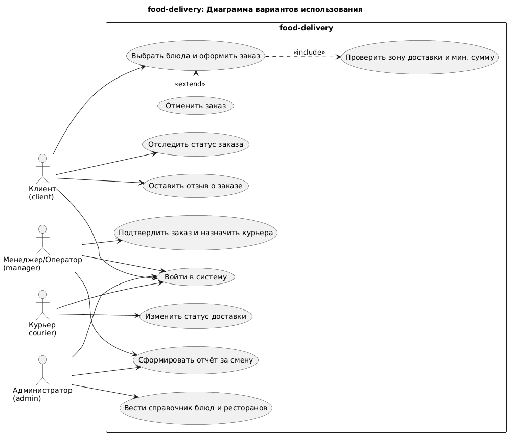
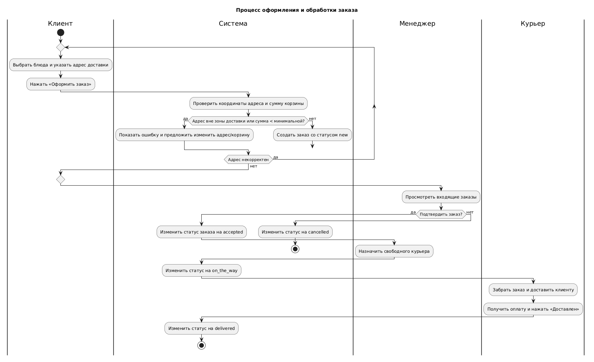
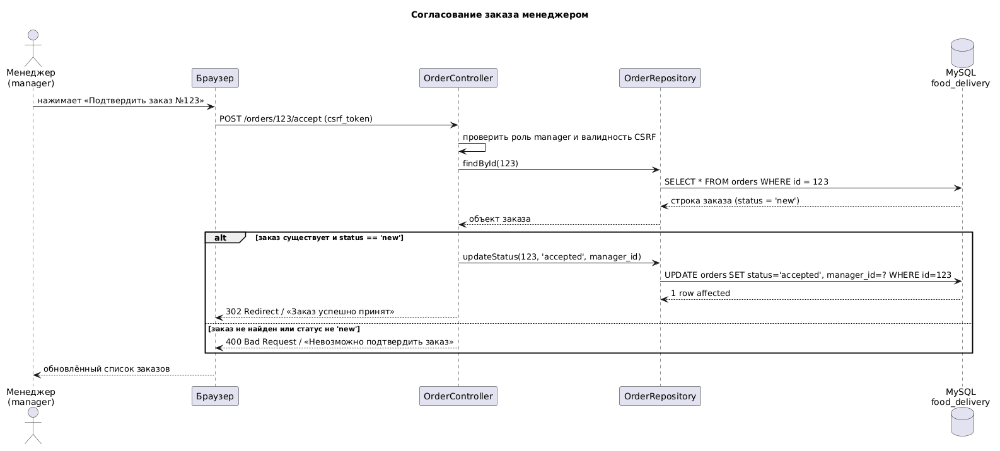
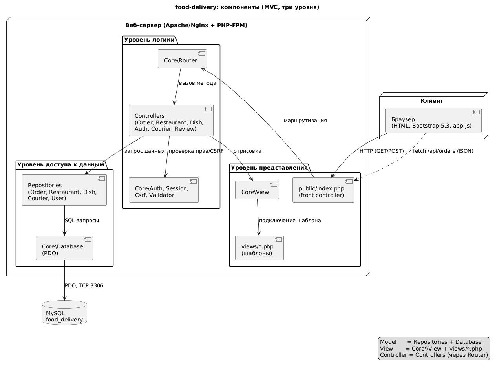
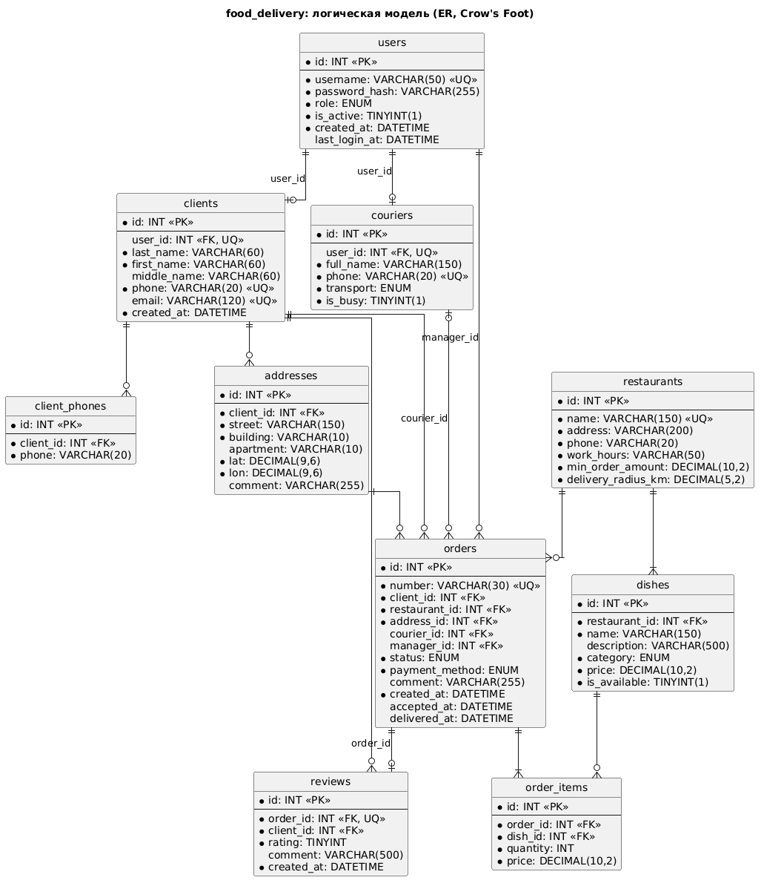
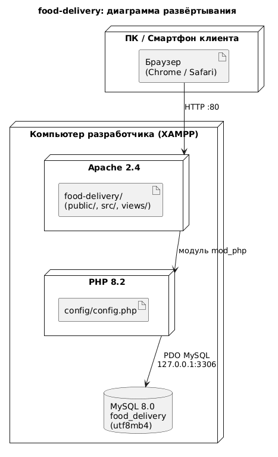

# Техническое задание на разработку системы веб для доставки еды "Болаззат"

**Версия:** 1.0  
**Дата:** 19.11.2026  
**Разработчик:** Наврузов М., гр. 4-40.01.01та  
**Заказчик:** Служба доставки "Болаззат" (условно)

---

## 1. Общие сведения

**Полное наименование системы:** Система веб для автоматизации процесса заказа и доставки еды "Болаззат".  
**Краткое наименование:** "Болаззат".  
**Заказчик:** Служба доставки "Болаззат".  
**Исполнитель:** Наврузов М.  
**Сроки выполнения:** Осенний семестр 2026 года (этапы 8–16 учебного плана).  
**Основание для разработки:** Учебный проект в рамках курса "Разработка веб-приложений".

---

## 2. Назначение и цели создания системы

### 2.1. Назначение
Система предназначена для полной автоматизации процесса приёма, обработки, логистики и доставки заказов еды от клиентов через единый веб-интерфейс.

### 2.2. Цели (измеримые)
1. **Сокращение времени обработки заказа:** с 15 минут (телефон + Excel) до 2 минут (веб-интерфейс).
2. **Устранение потерь заказов:** снижение количества потерянных заказов с 15–20 в месяц до 0 (все заказы фиксируются в БД).
3. **Прозрачность для клиента:** предоставление клиенту возможности отслеживать статус заказа в реальном времени (`new` → `accepted` → `cooking` → `on_the_way` → `delivered`).
4. **Автоматический расчёт:** система автоматически считает сумму заказа, комиссию ресторана и оплату курьера.
5. **Аналитика:** администратор получает отчёты о продажах, популярных блюдах и эффективности курьеров за 1 клик.

---

## 3. Характеристика объекта автоматизации

### 3.1. Описание объекта
Служба доставки "Болаззат" работает как агрегатор, соединяющий клиентов с ресторанами-партнёрами и курьерами. В текущем процессе заказы принимаются по телефону и через Telegram, записываются в Excel, передаются на кухню через мессенджеры, а курьеры координируются через группы в Telegram.

### 3.2. Акторы (роли)
- **Муштарӣ (client)** — конечный пользователь, заказывающий еду.
- **Менеджер (manager)** — оператор, принимающий и обрабатывающий заказы.
- **Курер (courier)** — доставляет заказы клиентам.
- **Администратор (admin)** — управляет меню, ресторанами, пользователями и отчётами.

### 3.3. Основные процессы
1. Клиент выбирает ресторан и блюда, оформляет заказ.
2. Менеджер подтверждает заказ и передаёт его на кухню.
3. Кухня готовит заказ.
4. Менеджер назначает свободного курьера.
5. Курьер забирает заказ и доставляет его клиенту.
6. Клиент получает заказ и ставит оценку.

### 3.4. Проблемы текущего процесса
- Потеря заказов при передаче информации через мессенджеры.
- Отсутствие отслеживания статуса для клиента.
- Ручной расчёт сумм приводит к финансовым ошибкам.
- Невозможность быстро получить аналитику по продажам из Excel.

### 3.5. Аналоги и выводы
- **Яндекс Еда:** Мощная платформа с GPS-трекингом, но высокая комиссия (20-30%) и отсутствие нативной поддержки местных платёжных систем (Alif, DC).
- **Glovo:** Международный агрегатор с широким функционалом, но дорог для локального бизнеса и не адаптирован к таджикскому рынку.
- **Вывод:** Необходима локальная система, которая дешевле международных аналогов, поддерживает местные платёжные системы и даёт владельцу полный контроль над данными клиентов.

---

## 4. Требования к системе

### 4.1. Требования к системе в целом
- **Надёжность:** Ежедневный автоматический бэкап базы данных; доступность системы 99% в рабочие часы (08:00–23:00).
- **Безопасность:** Пароли хранятся в хешированном виде (bcrypt); разграничение доступа по ролям; защита от SQL-инъекций через подготовленные выражения (prepared statements).
- **Производительность:** Загрузка главной страницы < 2 секунд; обработка запроса на создание заказа < 1 секунды.
- **Персонал:** Система должна быть интуитивно понятна, время обучения нового сотрудника не превышает 1 часа.

### 4.2. Требования к функциям

#### Функциональные требования (ФТ) с приоритетами MoSCoW
**Must (обязательно):**
- ФТ-01: Регистрация и вход в систему.
- ФТ-02: Просмотр меню ресторана.
- ФТ-03: Добавление блюда в корзину.
- ФТ-04: Оформление заказа.
- ФТ-05: Отслеживание статуса заказа.
- ФТ-06: Приём заказа менеджером.
- ФТ-07: Назначение курьера на заказ.
- ФТ-08: Изменение статуса заказа курьером.
- ФТ-09: Оставление оценки и отзыва.
- ФТ-10: Управление меню админом.

**Should (желательно):**
- ФТ-11: Онлайн-оплата через Alif/DC.
- ФТ-12: Фильтр блюд по категориям.

**Could (возможно):**
- ФТ-13: История заказов.
- ФТ-14: Программа лояльности.

**Won't (вне границ MVP):**
- Мобильное приложение (iOS/Android).
- GPS-трекинг курьера в реальном времени на карте.
- Интеграция с 1C.

#### User Stories (примеры)
1. **US-01:** Как *муштарӣ*, я хочу зарегистрироваться и войти в систему, чтобы оформлять заказы. *(Must, ФТ-01)*
2. **US-02:** Как *муштарӣ*, я хочу выбрать ресторан и блюда, чтобы оформить заказ. *(Must, ФТ-02, ФТ-03)*
3. **US-03:** Как *муштарӣ*, я хочу видеть статус моего заказа в реальном времени, чтобы знать, когда придёт еда. *(Must, ФТ-05)*
4. **US-04:** Как *менеджер*, я хочу подтвердить заказ и назначить курьера, чтобы организовать доставку. *(Must, ФТ-06, ФТ-07)*
5. **US-05:** Как *курер*, я хочу изменить статус заказа на "доставлен", чтобы закрыть заказ. *(Must, ФТ-08)*
6. **US-06:** Как *муштарӣ*, я хочу поставить оценку после доставки, чтобы поделиться мнением. *(Must, ФТ-09)*
7. **US-07:** Как *админ*, я хочу добавить новое блюдо в меню, чтобы клиенты могли его заказать. *(Must, ФТ-10)*

#### Матрица доступа «роль × функция»

| Функция | admin | manager | courier | client |
| :--- | :---: | :---: | :---: | :---: |
| ФТ-01: Регистрация/вход | да | да | да | да |
| ФТ-02: Просмотр меню | да | да | да | да |
| ФТ-03: Добавление в корзину | — | — | — | да |
| ФТ-04: Оформление заказа | — | — | — | да |
| ФТ-05: Просмотр статуса | да | да | да (своих) | да (своих) |
| ФТ-06: Подтверждение заказа | — | да | — | — |
| ФТ-07: Назначение курьера | — | да | — | — |
| ФТ-08: Изменение статуса | — | — | да (своих) | — |
| ФТ-09: Оценка заказа | — | — | — | да (своих) |
| ФТ-10: Управление меню | да | — | — | — |
| ФТ-11: Онлайн-оплата | — | — | — | да |
| ФТ-12: Фильтр блюд | — | — | — | да |

### 4.3. Требования к видам обеспечения
- **Информационное:** База данных `bolazzat_db`, 10 таблиц, нормализация до 3НФ, кодировка `utf8mb4_unicode_ci` для поддержки кириллицы.
- **Программное:** PHP 8.2+, MySQL 8.0+ / MariaDB 10.6+, phpMyAdmin, HTML5, CSS3, JavaScript (vanilla), Bootstrap 5.3. Без тяжёлых PHP-фреймворков.
- **Техническое:** VDS (виртуальный выделенный сервер): 1 vCPU, 1 ГБ RAM, 10 ГБ SSD, ОС Ubuntu 22.04 LTS, веб-сервер Apache/Nginx.
- **Лингвистическое:** Интерфейс на таджикском и русском языках; ввод и поиск данных на кириллице без искажений (UTF-8).

---

## 5. Модели системы

### 5.1. Варианты использования
  
*Рис. 1. Четыре роли (муштарӣ, менеджер, курер, админ) и варианты использования. Каждому Must-требованию соответствует вариант использования.*

### 5.2. Процесс «Оформление и доставка заказа»
  
*Рис. 2. Диаграмма деятельности показывает путь заказа от создания до доставки с разделением по ролям (swimlanes).*

  
*Рис. 3. Диаграмма последовательности показывает взаимодействие между клиентом, контроллером, сервисом и базой данных.*

### 5.3. Структура
  
*Рис. 4. Диаграмма классов показывает 10 сущностей и связи между ними (1:N, M:N через order_items).*

  
*Рис. 5. Диаграмма компонентов показывает трёхуровневую архитектуру: представление (frontend), логика (PHP MVC), данные (MySQL).*

### 5.4. Данные и развёртывание
  
*Рис. 6. ER-диаграмма показывает 10 таблиц, их поля, первичные и внешние ключи, связи.*

  
*Рис. 7. Диаграмма развёртывания показывает физическую архитектуру: клиент → веб-сервер (PHP) → база данных (MySQL).*

---

## 6. Состав и содержание работ

| Этап | Работы | Результат | Срок |
| :--- | :--- | :--- | :--- |
| 1. Проектирование | Анализ, ТЗ, модели UML, проектирование БД | Данный документ, `schema.sql` | День 8 (РК-1) |
| 2. Дизайн | UX/UI дизайн в Figma | Макет и прототип | День 9 |
| 3. Frontend | Вёрстка HTML/CSS, JavaScript | Статические страницы | Дни 10–11 |
| 4. Backend | Разработка PHP-логики, подключение к БД, авторизация | Работающий MVP | Дни 12–14 |
| 5. Тестирование | Написание тест-кейсов, ручное тестирование | `15-test-cases.md` | День 15 |
| 6. Публикация | Развёртывание на VDS, настройка HTTPS | Сайт в интернете | День 16 (РК-2) |

---

## 7. Порядок контроля и приёмки

### 7.1. Критерии приёмки
Система принимается, если:
1. Выполнены 100% Must-требований (ФТ-01 — ФТ-10).
2. Все user stories проходят испытания на тестовых аккаунтах.
3. Нет ошибок с приоритетом "критический".
4. НФТ выполнены (скорость загрузки < 2 сек, бэкапы работают).

### 7.2. Порядок испытаний
1. **Подготовка тестовых данных:**
   - Выполнить `schema.sql` (создание структуры БД).
   - Выполнить `seed.sql` (заполнение тестовыми данными).
   - Использовать тестовые логины: `client1`, `manager1`, `courier1`, `admin1` (пароль: `Secret123!`).
2. **Проверка Must-историй:**
   - US-01: Войти как `client1` → успешно.
   - US-02: Выбрать ресторан, добавить блюда в корзину → корзина заполнена.
   - US-03: Оформить заказ → заказ создан со статусом `new`.
   - US-04: Войти как `manager1`, подтвердить заказ → статус `accepted`.
   - US-05: Войти как `courier1`, изменить статус → статус `on_the_way`.
   - US-06: Изменить статус на `delivered` → заказ закрыт.
   - US-07: Войти как `client1`, поставить оценку → отзыв сохранён в таблице `reviews`.
   - US-08: Войти как `admin1`, добавить блюдо → блюдо появилось в меню.
3. **Проверка НФТ:**
   - Скорость: открыть главную страницу, замерить время загрузки (должно быть < 2 сек).
   - Бэкап: проверить наличие ежедневного бэкапа БД.
4. **Приёмка:** Если все тесты пройдены — система принята.

---

## 8. Требования к документированию

**Список документов:**
1. `README.md` — описание проекта, инструкция по установке.
2. `docs/08-technical-specification.md` — данное техническое задание.
3. `docs/user-manual.md` — руководство пользователя (для менеджера, курьера, админа).
4. `docs/16-deploy.md` — инструкция по развёртыванию на VDS.
5. `database/schema.sql` — скрипт создания структуры БД.
6. `database/seed.sql` — скрипт заполнения тестовыми данными.
7. `database/queries.sql` — контрольные SQL-запросы.

---

## 9. Источники разработки

**Нормативные документы:**
- ГОСТ 34.602-89 "Техническое задание на создание автоматизированной системы".

**Литература и документация:**
- Официальная документация PHP: https://www.php.net/manual/ru/
- Официальная документация MySQL: https://dev.mysql.com/doc/
- Bootstrap 5: https://getbootstrap.com/docs/5.3/

**Аналоги:**
- Яндекс Еда: https://eda.yandex/
- Glovo: https://glovoapp.com/