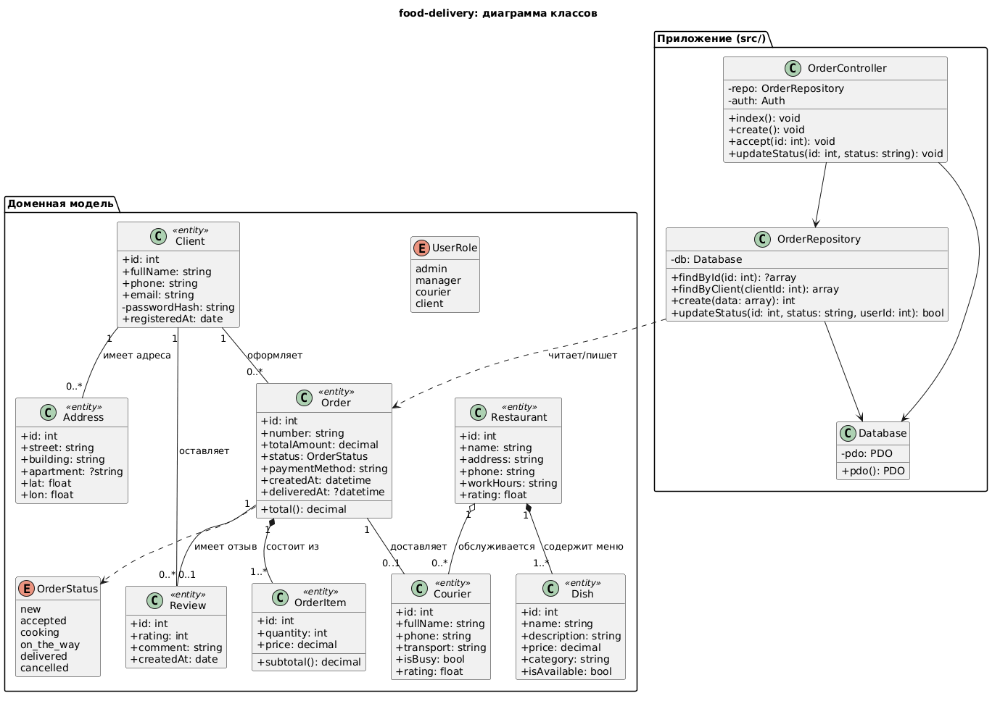

# Техническое задание на разработку системы доставки еды «Болаззат»

**Версия:** 1.0  
**Дата:** 19.11.2026  
**Разработчик:** Наврузов Манучехр, гр. 4-40.01.01та  
**Заказчик:** Сеть тарабхонаҳои «Болаззат» (шартӣ)

---

## 1. Общие сведения

**Полное наименование системы:** Информационная веб-система автоматизации процессов приёма и доставки заказов еды «Болаззат».

**Краткое наименование:** Система «Болаззат».

**Заказчик:** Сеть тарабхонаҳои «Болаззат», осуществляющая доставку еды в г. Душанбе.

**Исполнитель:** Наврузов Манучехр, студент группы 4-40.01.01та.

**Сроки разработки:** Осенний семестр 2026 года (в рамках учебного курса).

**Основание для разработки:** Лабораторные работы №1–7, выполненные в ходе курса по веб-разработке.

---

## 2. Назначение и цели создания системы

**Назначение:** Автоматизация полного цикла обработки заказа на доставку еды — от выбора блюда клиентом до передачи заказа клиенту курьером и получения оценки.

**Измеримые цели:**

| № | Цель | Текущее состояние | Целевое состояние |
|---|------|-------------------|-------------------|
| 1 | Скорость приёма заказа | 15 мин (телефон) | 3 мин (веб-интерфейс) |
| 2 | Потеря заказов в месяц | 15–20 заказов | 0 заказов |
| 3 | Время на формирование отчёта о продажах | 4 часа (Excel) | 5 секунд (SQL-запрос) |
| 4 | Загрузка оператора (в пиковые часы) | 70% времени — ответы на «где мой заказ?» | 10% времени |
| 5 | Ошибки при расчёте суммы заказа | 5–7% заказов | 0% |

---

## 3. Характеристика объекта автоматизации

### 3.1. Описание организации

Сеть тарабхонаҳои «Болаззат» работает в сфере доставки еды. В настоящее время заказы принимаются преимущественно через телефон и Telegram-бот, фиксируются в Google Sheets и передаются в тарабхона и курьерам через группы в Telegram. Такой ручной процесс приводит к потере заказов, ошибкам в расчётах, отсутствию отслеживания статуса для клиента и сложностям при формировании отчётности.

### 3.2. Акторы (роли) системы

- **Муштарӣ (client)** — конечный пользователь, оформляющий заказ и оплачивающий его.
- **Менеджер (manager)** — оператор, принимающий и подтверждающий заказы, назначающий курьеров.
- **Курер (courier)** — сотрудник, доставляющий заказ клиенту.
- **Администратор (admin)** — пользователь с полными правами управления системой (меню, тарабхона, пользователи, отчёты).

### 3.3. Основные бизнес-процессы

1. Приём и оформление заказа.
2. Подтверждение заказа менеджером.
3. Приготовление заказа в тарабхона.
4. Назначение курьера и доставка.
5. Оплата и получение оценки от клиента.
6. Управление меню и формирование отчётности.

### 3.4. Глоссарий терминов

| Термин | Определение |
|--------|-------------|
| Фармоиш (Order) | Набор выбранных блюд с адресом доставки, способом оплаты и статусом |
| Ҳолати фармоиш (Status) | Текущий этап выполнения заказа (new, accepted, cooking, on_the_way, delivered, cancelled) |
| Минтақаи дастраскунӣ (Delivery zone) | Географическая зона, в пределах которой осуществляется доставка |
| Позицияи фармоиш (Order item) | Единица блюда в заказе с количеством и ценой |
| Сабади харид (Shopping cart) | Временный механизм накопления выбранных блюд перед оформлением заказа |

### 3.5. Выводы из анализа аналогов

Анализ показал, что глобальные агрегаторы («Яндекс Еда», «Glovo») слишком дороги для местных тарабхона (высокая комиссия), а локальные Telegram-боты недостаточно функциональны (нет отслеживания статуса, сложное управление меню, отсутствует аналитика). Система «Болаззат» заполняет нишу между этими решениями: дешевле агрегаторов, функциональнее ботов и адаптирована под местные платёжные системы (Alif, DC).

---

## 4. Требования к системе

### 4.1. Требования к системе в целом

#### Нефункциональные требования (НФТ):

| № | Требование | Значение | Как проверить |
|---|------------|----------|---------------|
| НФТ-01 | Скорость загрузки страницы | < 2 секунды | Lighthouse в Chrome DevTools |
| НФТ-02 | Доступность системы (uptime) | ≥ 99% в рабочие часы | Мониторинг через UptimeRobot |
| НФТ-03 | Резервное копирование БД | Ежедневно в 02:00 | Проверка cron-задачи и наличия бэкапа |
| НФТ-04 | Поддержка одновременных пользователей | ≥ 100 | Нагрузочное тестирование через Apache JMeter |
| НФТ-05 | Время отклика API | < 500 мс | Postman/Insomnia |
| НФТ-06 | Защита от SQL-инъекций | Использование PDO с prepared statements | Статический анализ кода |
| НФТ-07 | Хранение паролей | bcrypt с солью | Проверка БД, пароли не в открытом виде |

#### Требования к надёжности:
- Ежедневный автоматический бэкап БД.
- Восстановление после сбоя — не более 1 часа.
- Логирование всех критических операций (удаление, изменение статуса).

#### Требования к безопасности:
- HTTPS для всех страниц.
- Защита от CSRF и XSS атак.
- Разграничение прав доступа по ролям (Role-Based Access Control).
- Хранение паролей только в хешированном виде.

#### Требования к персоналу:
- Для работы с системой достаточно базовых навыков работы с браузером.
- Обучение менеджера — 2 часа, курьера — 30 минут, администратора — 4 часа.

### 4.2. Требования к функциям

#### Функциональные требования (ФТ) с приоритетами MoSCoW:

| № | Требование | Приоритет |
|---|-----------|-----------|
| ФТ-01 | Регистрация и вход в систему | Must |
| ФТ-02 | Просмотр списка тарабхона и меню | Must |
| ФТ-03 | Добавление блюд в корзину | Must |
| ФТ-04 | Оформление заказа с выбором адреса и способа оплаты | Must |
| ФТ-05 | Отслеживание статуса заказа в реальном времени | Must |
| ФТ-06 | Подтверждение/отмена заказа менеджером | Must |
| ФТ-07 | Назначение курьера менеджером | Must |
| ФТ-08 | Изменение статуса заказа курьером | Must |
| ФТ-09 | Оценка заказа клиентом | Must |
| ФТ-10 | Управление меню (CRUD блюд) администратором | Must |
| ФТ-11 | Онлайн-оплата через Alif/DC | Should |
| ФТ-12 | SMS-уведомления о статусе заказа | Should |
| ФТ-13 | Программа лояльности (бонусы) | Could |
| ФТ-14 | Мобильное приложение | Won't |
| ФТ-15 | GPS-трекинг курьера в реальном времени | Won't |

#### User Stories:

1. **US-01:** Как клиент, я хочу оформить заказ, чтобы горячая еда была доставлена по моему адресу.
2. **US-02:** Как клиент, я хочу отслеживать статус заказа, чтобы знать, когда курьер приедет.
3. **US-03:** Как менеджер, я хочу подтвердить заказ, чтобы он попал в тарабхона.
4. **US-04:** Как курьер, я хочу видеть назначенные мне заказы, чтобы их доставить.
5. **US-05:** Как администратор, я хочу управлять меню, чтобы обновлять ассортимент блюд.

#### Матрица доступа (роль × функция):

| Функция | client | manager | courier | admin |
|---------|--------|---------|---------|-------|
| Регистрация и вход | да | да | да | да |
| Просмотр меню и тарабхона | да | просмотр | просмотр | да |
| Оформление заказа | да | — | — | — |
| Отслеживание своих заказов | свои | все | свои | все |
| Подтверждение заказов | — | да | — | — |
| Назначение курьера | — | да | — | — |
| Изменение статуса доставки | — | — | свои | — |
| Оценка заказа | свои | — | — | — |
| Управление меню | — | — | — | да |
| Управление тарабхона | — | — | — | да |
| Управление пользователями | — | — | — | да |
| Просмотр отчётов | — | свои | свои | все |

### 4.3. Требования к видам обеспечения

- **Информационное обеспечение:** БД `bolazzat` в MySQL 8.0, 10 таблиц (`users`, `clients`, `client_phones`, `addresses`, `restaurants`, `dishes`, `couriers`, `orders`, `order_items`, `reviews`), нормализация до 3НФ, кодировка `utf8mb4_unicode_ci`.
- **Программное обеспечение:** PHP 8.2+, MySQL 8.0 / MariaDB 10.6+, Bootstrap 5.3, Composer (PSR-4), сервер Apache/Nginx + PHP-FPM, phpMyAdmin для администрирования БД.
- **Техническое обеспечение:** VDS с 1 vCPU, 1 ГБ RAM, 10 ГБ SSD, канал интернета 100 Мбит/с (см. диаграмму развёртывания в разд. 5.4).
- **Лингвистическое обеспечение:** интерфейс на таджикском и русском языках; ввод и поиск данных на кириллице без искажений (UTF-8).

---

## 5. Модели системы

### 5.1. Диаграмма вариантов использования (Use Case)

**Рис. 1.** Диаграмма вариантов использования отображает 4 акторов (client, manager, courier, admin) и основные сценарии их взаимодействия с системой. Каждому Must-требованию соответствует свой вариант использования.

### 5.2. Диаграмма деятельности (Activity)

**Рис. 2.** Диаграмма показывает процесс оформления заказа с момента выбора блюда клиентом до доставки курьером. Использованы swimlanes для разделения ответственности между акторами.

### 5.3. Диаграмма последовательности (Sequence)

**Рис. 3.** Диаграмма последовательности иллюстрирует взаимодействие компонентов (Client → Controller → Service → Repository → MySQL) при подтверждении заказа менеджером.

### 5.4. Диаграмма классов (Class)

**Рис. 4.** Диаграмма классов отражает логическую структуру системы: 10 основных сущностей и связи между ними (1:N, M:N через order_items).

### 5.5. Диаграмма компонентов (Component)

**Рис. 5.** Диаграмма компонентов отображает архитектуру MVC: слой представления (View), бизнес-логика (Controller, Service) и слой данных (Repository, MySQL).

### 5.6. ER-диаграмма базы данных

**Рис. 6.** ER-диаграмма в нотации Crow's Foot показывает физическую структуру БД: 10 таблиц с первичными и внешними ключами, ограничениями UNIQUE и CHECK.

### 5.7. Диаграмма развёртывания (Deployment)

**Рис. 7.** Диаграмма развёртывания показывает физическое размещение компонентов: VDS-сервер с Apache и PHP, MySQL-сервер, клиенты через браузер.

---

## 6. Состав и содержание работ

| № | Этап | Работы | Результат | Срок |
|---|------|--------|-----------|------|
| 1 | Проектирование | Анализ, ТЗ, модели, БД | Данный документ, schema.sql | День 8 (РК-1) |
| 2 | Дизайн | UX/UI в Figma | Макет и прототип | День 9 |
| 3 | Frontend | Вёрстка, JS | Статические страницы | Дни 10–11 |
| 4 | Backend | PHP, БД, авторизация | Работающий MVP | Дни 12–14 |
| 5 | Тестирование | Тест-кейсы, PHPUnit | 15-test-cases.md | День 15 |
| 6 | Публикация | VDS, HTTPS | Сайт в интернете | День 16 (РК-2) |

---

## 7. Порядок контроля и приёмки

### 7.1. Критерий приёмки

Система считается **принятой**, если:
1. Выполнены 100% Must-требований из таблицы ФТ.
2. Все 5 user stories успешно проходят испытания на тестовых логинах:
   - client1 / Secret123!
   - manager1 / Secret123!
   - courier1 / Secret123!
   - admin1 / Secret123!
3. Нет ошибок с приоритетом «критический» (потеря данных, падение системы).
4. Все НФТ проверены способами из раздела 4.1.

### 7.2. Порядок испытаний

1. **Установка:** выполнить `schema.sql` и `seed.sql` в phpMyAdmin.
2. **Проверка НФТ:** замерить скорость загрузки главной страницы через Lighthouse (должна быть < 2 сек).
3. **Тестирование user stories:**
   - US-01: client1 логинится → выбирает тарабхона → добавляет блюда → оформляет заказ → проверяет статус.
   - US-02: client1 открывает страницу заказов → видит актуальный статус.
   - US-03: manager1 логинится → видит новый заказ → подтверждает его.
   - US-04: courier1 логинится → видит назначенный заказ → меняет статус на delivered.
   - US-05: admin1 логинится → создаёт новое блюдо → проверяет его появление в меню.
4. **Проверка SQL-запросов:** выполнение одного из запросов `queries.sql` и проверка результата.
5. **Проверка НФТ-03:** наличие файла бэкапа в директории `/backups/` за текущую дату.

---

## 8. Требования к документированию

В процессе разработки создаются следующие документы:

| № | Документ | Расположение |
|---|----------|--------------|
| 1 | README проекта | `/README.md` |
| 2 | Полное техническое задание | `/docs/08-technical-specification.md` |
| 3 | Анализ предметной области | `/docs/01-domain-analysis.md` |
| 4 | Матрица сравнения аналогов | `/docs/02-comparison-matrix.md` |
| 5 | Краткое ТЗ | `/docs/03-short-spec.md` |
| 6 | Диаграммы поведения | `/docs/04-behavior/*.puml` |
| 7 | Диаграммы структуры | `/docs/05-structure/*.puml` |
| 8 | Логическая модель БД | `/docs/06-logical-model.md` |
| 9 | Диаграмма развёртывания | `/docs/07-deployment.puml` |
| 10 | SQL-скрипты БД | `/database/schema.sql`, `/database/seed.sql`, `/database/queries.sql` |
| 11 | Руководство пользователя | `/docs/16-user-guide.md` |
| 12 | Инструкция по развёртыванию | `/docs/16-deploy.md` |

---

## 9. Источники разработки

1. ГОСТ 34.602-89 «Техническое задание на создание автоматизированной системы».
2. Официальная документация PHP 8.2 — https://www.php.net/docs.php
3. Официальная документация MySQL 8.0 — https://dev.mysql.com/doc/
4. Документация Bootstrap 5.3 — https://getbootstrap.com/docs/5.3/
5. Стандарт UML 2.5.1 — https://www.omg.org/spec/UML/2.5.1
6. Материалы курса «Веб-разработка».